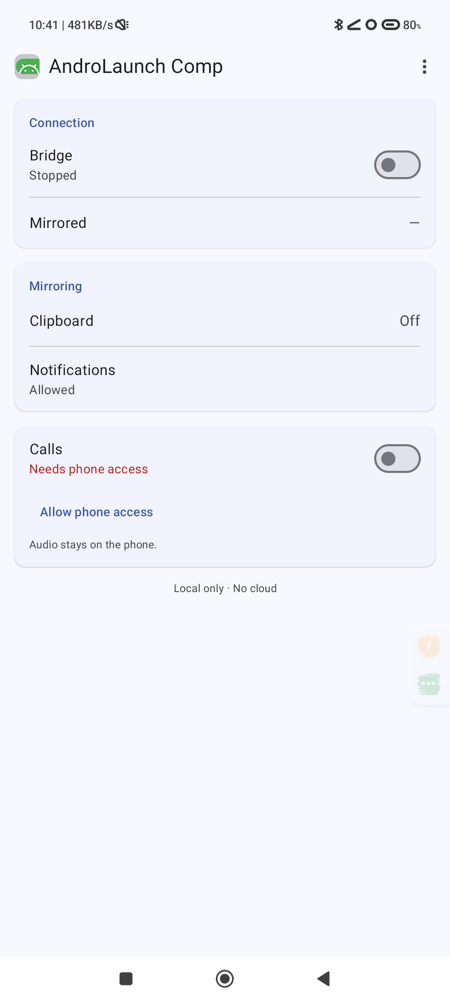
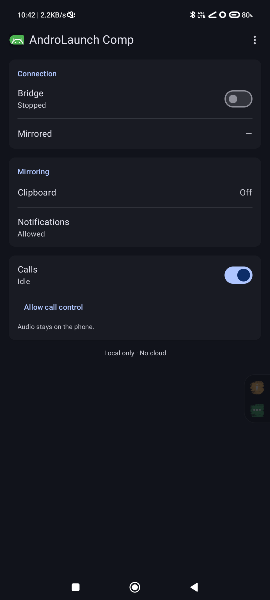
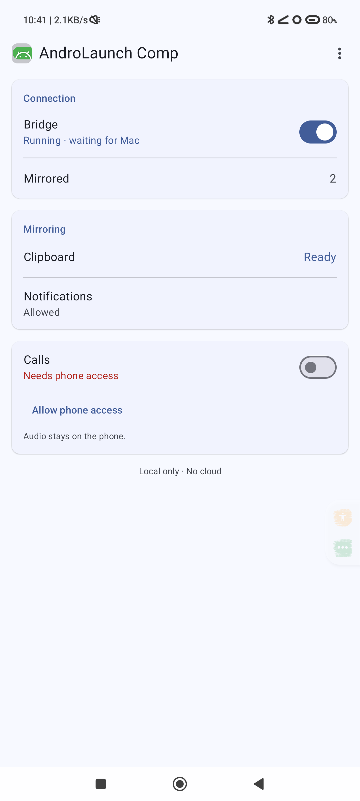
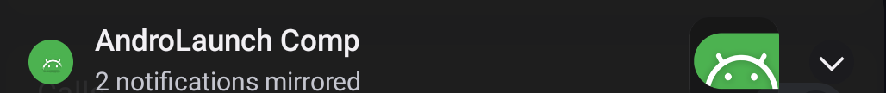

# AndroLaunch Comp (Android)

**AndroLaunch Comp** is the phone half of AndroLaunch's continuity features. It
replaces the third-party `ch.pete.adbclipboard` app: clipboard text from the Mac
is written by this app, notifications are served as parsed platform data, and
call state can be reported (and, best-effort, answered or declined) over the same
channel.

The rename is display-only. The package is still
`com.senpai.androlaunch.companion`, the service component is still
`.CompanionService`, and the APK is still `AndroLaunchCompanion.apk`, so existing
installs keep updating and the macOS app keeps working.

Nothing here talks to the network beyond a **loopback socket**. The companion
listens on `127.0.0.1:27777` and the Mac reaches it through `adb forward`, so
traffic never leaves the USB cable or the local ADB-over-Wi-Fi link. There is no
account, no cloud, no pairing step beyond the ADB authorization you already
approved, and no analytics.

---

## What works today

| Capability | How |
| --- | --- |
| Mac → Android clipboard | `clip.set` over the socket, writes text into the clipboard |
| Android → Mac clipboard | scrcpy's mirrored session (Android forbids background clipboard reads); `clip.get` covers the foreground case |
| Notification capture | `NotificationListenerService`, served as `notif.list` (memory-only, 80 entries) |
| Call awareness | opt-in `call.state`: `idle` / `ringing` / `offhook` + `incoming`, `since` |
| Call control | best-effort `call.answer` / `call.end` via `TelecomManager` with `ANSWER_PHONE_CALLS` |
| Connection notification | brand-colored, live connection/call status with Open / Stop and contextual call actions |

**What calls do *not* do:** call audio is never captured or played on the Mac,
and there is no Mac-side call UI yet. Answer/decline are best-effort and depend
on the phone's dialer. Voice-over-IP calls in apps that use self-managed
connections may not be reported or controllable. See
[`docs/continuity-architecture.md`](../docs/continuity-architecture.md)
for the full before/after and caveats.

---

## The app

**AndroLaunch Comp** is a small **Jetpack Compose + Material 3** control panel.
The UI is Kotlin/Compose (Material 3 cards, rows, switches, dialogs and menus),
follows the system light/dark theme automatically, and uses **Material You
dynamic color** on Android 12+ with a brand-green fallback palette below that.
The real app icon appears in the top app bar, the About dialog and the
notification.

- **Top app bar** — the real app icon, "AndroLaunch Comp", and a Material 3
  overflow `DropdownMenu` (Restart service, Copy ADB command, Notification
  settings, Privacy, About).
- **Connection card** — Material 3 `ElevatedCard` with a Bridge row (switch +
  "Running · waiting for Mac" / "Stopped") and a mirrored-count row.
- **Mirroring card** — Clipboard (Ready/Off) and Notifications (Allowed/Needs
  access + Allow) rows.
- **Calls card** — one row with the awareness switch and a one-line state ("Off" /
  "Needs phone access" / "Idle" / "Ringing" / "In call"), exactly one contextual
  action (Allow phone access / Allow call control / Answer + Decline / End call)
  and a short "Audio stays on the phone." line.
- **About dialog** — Compose `AlertDialog` with the app icon, version and protocol
  number (not repeated on the main screen, keeping it terse).







### Foreground notification

The service runs with a persistent notification on the `connection_status`
channel. It is a compact native notification, not a debug placeholder:

| Property | Value |
| --- | --- |
| Channel | `connection_status` — "Connection status", default importance, no sound or vibration, no badge, brand-colored light |
| Look | small brand glyph, `#4CB250` accent color, the real app icon as the large icon |
| Title | "AndroLaunch Comp" |
| Live text (one short line) | "Ready for your Mac" / "Synced just now" / "N notifications mirrored" / "Incoming call" / "In call" |
| Actions | **Open** and **Stop**; **Answer** / **Decline** while ringing (call control granted) or **End call** while in a call |
| Behavior | ongoing, only-alert-once, no timestamp, public visibility, immediate foreground-service behavior on Android 12+ |

The legacy `companion` channel is deleted on start, so upgrades don't leave a
stale importance-min channel behind.



The palette lives in `res/values/colors.xml` and `res/values-night/colors.xml`
(brand `#4CB250` accent, platform surfaces in both modes). Device captures belong
in [`screenshots/`](screenshots/).

---

## Calls

Calling is **opt-in and split into two grants**, so nobody is opted into phone
access by installing an APK:

1. **Call awareness** — `READ_PHONE_STATE`. The companion registers
   `TelephonyCallback.CallStateListener` on Android 12+ and the legacy
   `PhoneStateListener` on Android 8–11, then exposes state through `call.state`.
2. **Call control** — `ANSWER_PHONE_CALLS`, requested separately. Answer/decline
   use `TelecomManager.acceptRingingCall()` / `endCall()` and report typed
   errors (`permission_required`, `not_ringing`, `failed`, `unsupported`).

Limits worth knowing:

- `acceptRingingCall()` and `endCall()` are deprecated since Android 10 in favour
  of `InCallService`; they still work for ordinary SIM calls with
  `ANSWER_PHONE_CALLS`, but they are best-effort.
- Self-managed calls (many VoIP apps) are only controllable when the caller is
  privileged/system UI.
- Emergency calls cannot be ended by `endCall()`.
- Tablets and Wi-Fi-only devices report `supported:false`.
- **Audio stays on the phone.** There is no supported third-party path to route a
  cellular call's audio to the Mac.

The macOS app installs the APK with `adb install -r` and pre-grants **only**
`POST_NOTIFICATIONS`; the two call permissions are requested inside AndroLaunch
Comp, by the user, on the Calls card.

---

## Build

The UI is **Jetpack Compose**; the daemon, notification relay and call monitor
remain plain Java in the same module. The build is Gradle (Android Gradle Plugin
8.7, Kotlin 2.0, Compose BOM 2024.10) and the wrapper pins Gradle 8.9.

```bash
# one-time toolchain
brew install --cask android-commandlinetools
export ANDROID_SDK_ROOT=/opt/homebrew/share/android-commandlinetools
yes | "$ANDROID_SDK_ROOT/cmdline-tools/latest/bin/sdkmanager" --licenses
"$ANDROID_SDK_ROOT/cmdline-tools/latest/bin/sdkmanager" \
  "platforms;android-34" "build-tools;34.0.0"

./android/build.sh          # -> android/AndroLaunchCompanion.apk
```

`build.sh` is a thin Gradle wrapper: it sets `JAVA_HOME` (Android Studio's JBR is
auto-detected) and a repo-local `GRADLE_USER_HOME`, runs
`./gradlew :app:assembleDebug`, and copies the APK to the path the macOS app
bundles. The first build needs network access while Gradle downloads the Android
Gradle Plugin, Kotlin and Compose; later builds are incremental. `local.properties`
points at the SDK (`sdk.dir`); keep it local, not committed. The debug keystore in
this directory signs local builds — keep the signing key stable so
`adb install -r` updates instead of failing with `update_incompatible`.

The Compose debug APK is ~9 MB (the previous View build was ~95 KB); this is the
expected cost of the AndroidX/Compose runtime and material design library.

Install and open it manually:

```bash
adb install -r android/AndroLaunchCompanion.apk
adb shell pm grant com.senpai.androlaunch.companion android.permission.POST_NOTIFICATIONS
adb shell am start -n com.senpai.androlaunch.companion/.MainActivity
```

The Mac app ships the APK in its bundle (`Contents/Resources`) and installs it
from the **Clipboard → Install AndroLaunch Comp** row.

Minimum supported Android version: **8.0 (API 26)**; `targetSdk 33` for now (see
the foreground-service note in the plan before bumping).

---

## Protocol v2

One request per line, one response per line, base64 for free-form text:

```
request : <id> \t <command> \t <base64 argument>
response: <id> \t ok|error \t <base64 payload>
```

| Command | Effect |
| --- | --- |
| `ping` | `companion/2/sdk<api>` (version 2; the word "companion" is part of the v1-compatible payload) |
| `clip.set` | writes the argument to the clipboard |
| `clip.get` | reads the clipboard, or `focus_required` |
| `notif.list` | JSON array of captured notifications: `{key,pkg,title,text,time,ongoing}` |
| `notif.clear` | drops the buffer |
| `call.state` | JSON call status (see below) |
| `call.answer` | best-effort answer of a ringing call; `answered` or a typed error |
| `call.end` | best-effort decline/end; `ended` or a typed error |

`call.state` response payload:

```json
{"supported":true,"permission":true,"enabled":true,"control":true,
 "state":"ringing","incoming":true,"since":1762345678901}
```

- `supported` — the device has telephony and the API is available.
- `permission` — `READ_PHONE_STATE` granted; `control` — `ANSWER_PHONE_CALLS`.
- `enabled` — the user turned call awareness on in the companion.
- `state` — `idle`, `ringing` or `offhook`.
- `incoming` — the ringing call is incoming; `since` — epoch millis when the
  state began.

`call.answer` errors: `unsupported`, `permission_required`, `not_ringing`,
`failed`. `call.end` returns the same set (it ends an active call too).

Unknown commands return `error unknown_command:<name>` and the connection stays
open, so a newer Mac app degrades instead of breaking.

---

## Privacy and security

- Notification text lives in memory only, capped at 80 entries, and is cleared on
  `notif.clear`. Nothing is written to disk. Logs contain lengths and state
  names, never clipboard or notification content.
- Call state is read locally and never recorded; no call audio is captured.
- Notification access is granted by the user in Settings and can be revoked there.
  The two call permissions are separate in-app grants and can be revoked at any
  time.
- The socket is loopback-only (`127.0.0.1`) and reachable only through ADB. As
  with any ADB channel, a device the user has authorized for debugging can reach
  it. There is no listener on Wi-Fi/Ethernet interfaces and no discovery.
- No analytics, no telemetry, no crash-reporting SDK. The `INTERNET` permission
  exists only because the socket is TCP on loopback.
- On Android 15+, the platform may redact sensitive notification content (OTPs,
  private notifications) from listener apps. That is expected; see the plan.

---

## Roadmap

The companion protocol is the extension point. The 12-month plan — notification
actions and inline reply, now-playing media controls, the macOS call surface,
clipboard images, ring-my-phone, widget/tile, and the honest call-audio verdict —
lives in
[`docs/continuity-architecture.md`](../docs/continuity-architecture.md).
